# DEV.SPOT – App de portfólio

Aplicativo mobile desenvolvido com **Expo** e **React Native** para a atividade prática. O projeto contém duas telas, navegação, componentes reutilizáveis e identidade visual inspirada no layout de referência.

## Integrantes
- Roni de Souza Aderaldo
- Pedro Sanches Biasini

## Funcionalidades
- Tela Home com logo, imagem ilustrativa, apresentação e botões de ação.
- Botão **Sobre mim** para navegar até a segunda tela.
- Botão **Entre em contato!** que exibe o alerta `Entre em contato`.
- Switch que exibe o alerta `Switch pressionado`.
- Botões de GitHub, LinkedIn, Instagram e Twitch que abrem as páginas das redes.
- Tela Sobre mim com biografia e rodapé de créditos.
- Componentes reutilizáveis e estilos organizados com `StyleSheet`.

## Tecnologias
- Expo
- React Native
- React Navigation
- JavaScript

## Como executar
1. Instale o Node.js LTS e o Expo Go no celular.
2. Extraia/clonar o projeto e abra a pasta `devspot-app` no VS Code.
3. No terminal, execute:

   ```bash
   npm install
   npx expo start
   ```

4. Leia o QR Code com o Expo Go no celular. No iPhone, use a câmera para abrir o link do Expo Go.
5. Para abrir no navegador, execute `npm run web` (pode exigir a instalação de dependências web do Expo).


## 📱 Telas do aplicativo


## 📱 Telas do aplicativo

### Modo escuro

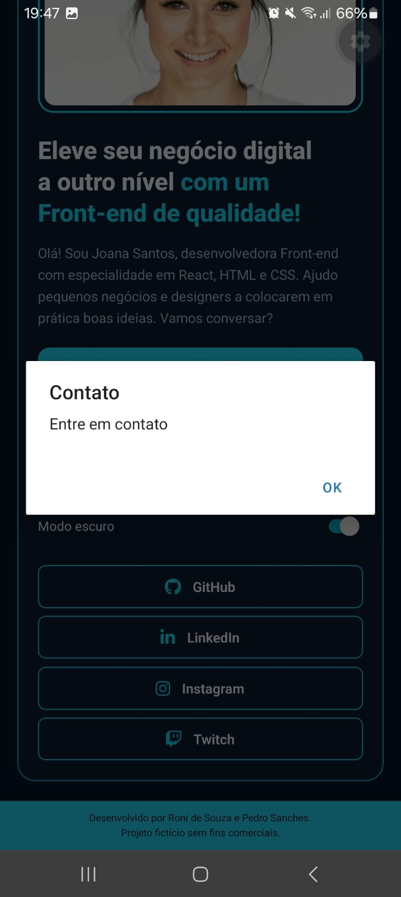

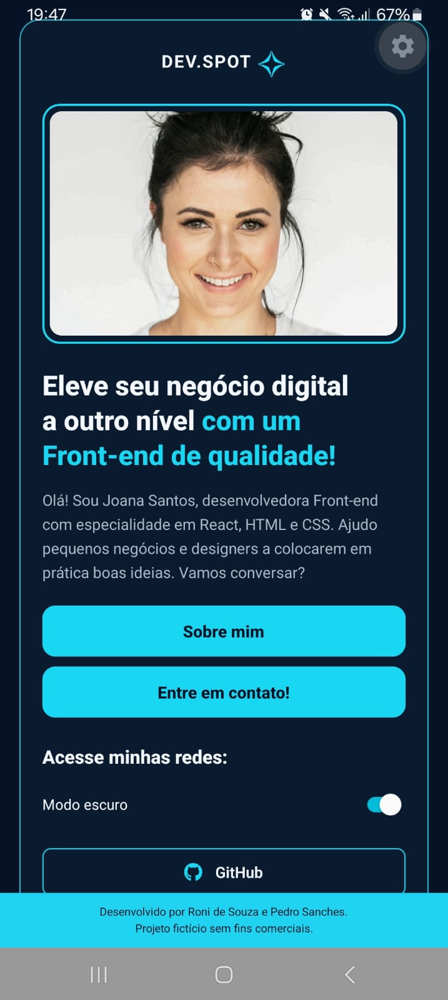

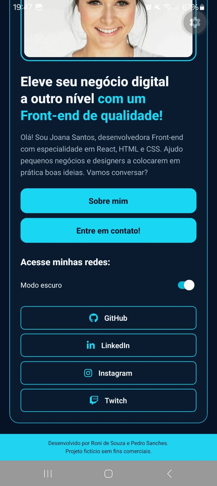

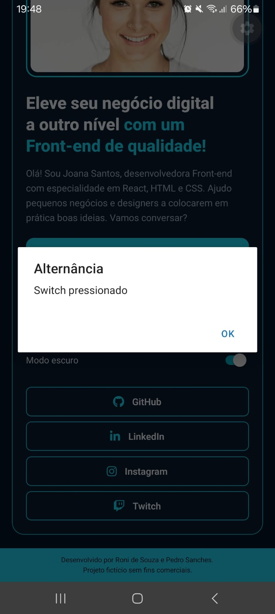

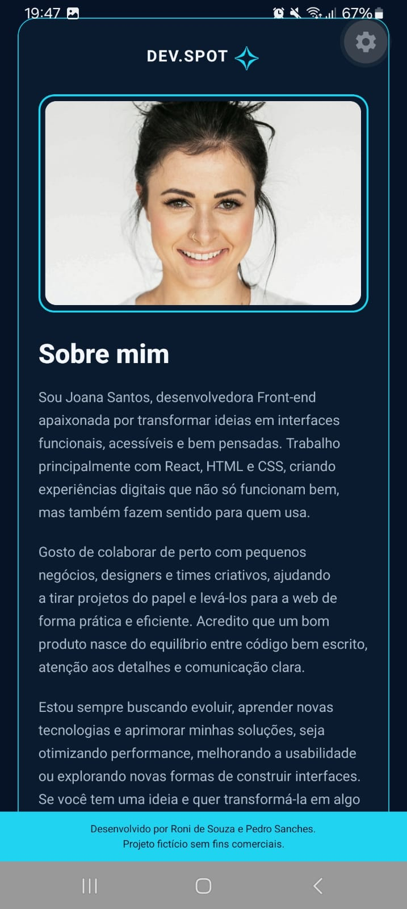

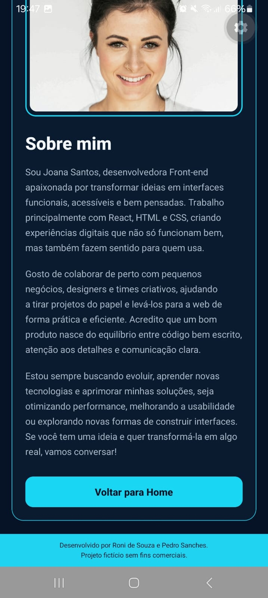

### Modo claro


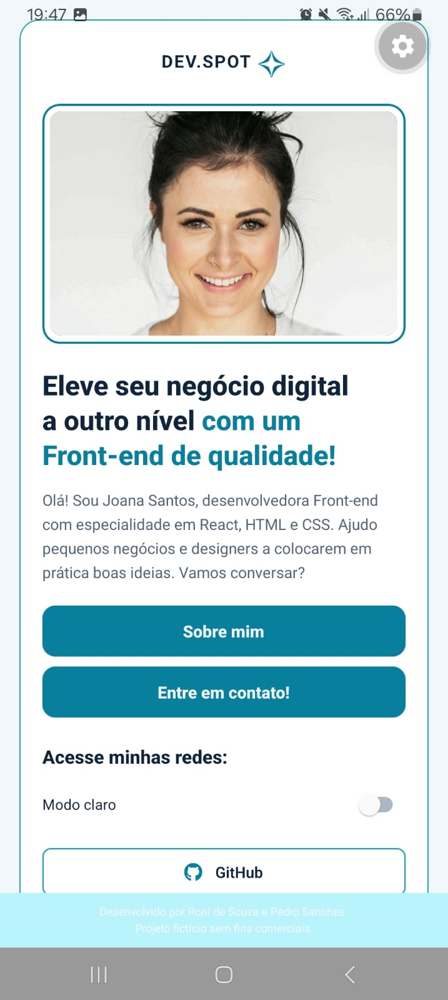

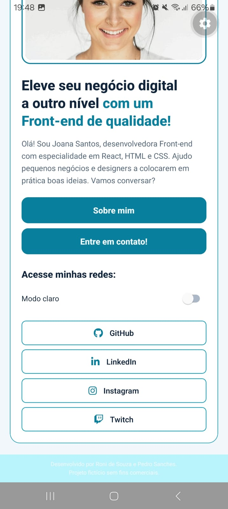

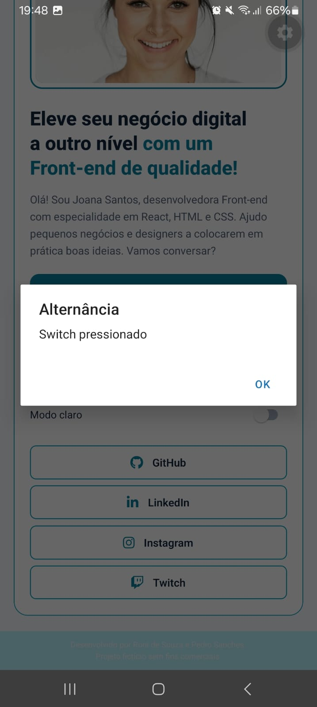

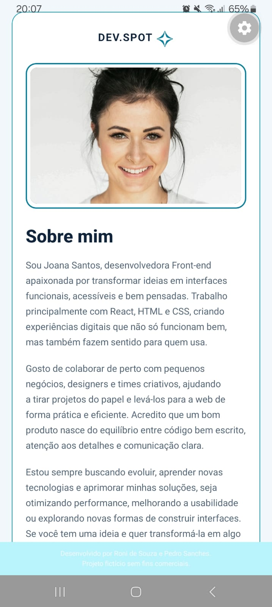

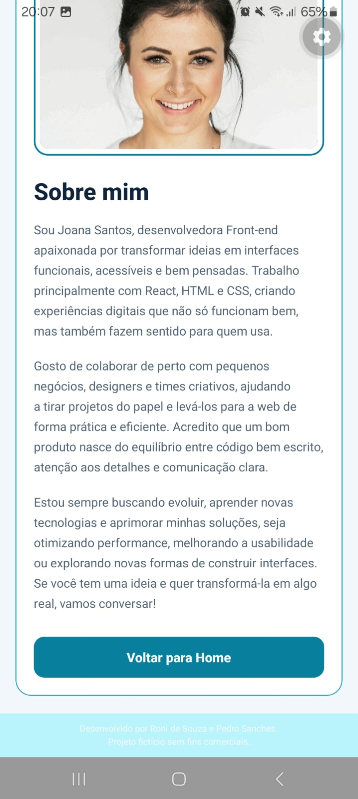
